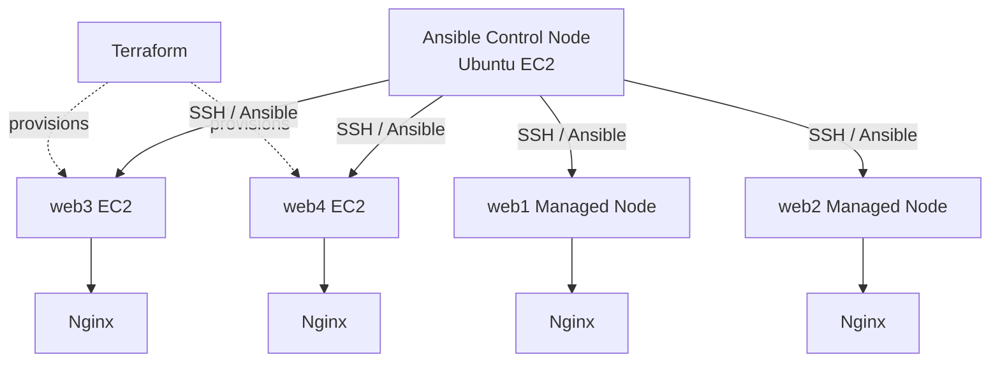

<p align="center">
  
</p>
<h1 align="center">Ansible Configuration Management and Automation</h1>
<p align="center">


</p>

## Overview

This project demonstrates infrastructure provisioning and configuration management on AWS using **Terraform and Ansible**.

A central Ansible Control Node manages four Ubuntu EC2 Managed Nodes over SSH. Ansible inventory defines the target machines, while reusable playbooks automate package installation, user management, Nginx deployment, service state, and configuration consistency.

The lab demonstrates **idempotency** and **configuration drift remediation**: after Nginx is manually stopped on one managed node, running the playbook restores the desired service state without changing healthy nodes.

## Tech Stack

| Technology | Purpose |
|---|---|
| AWS EC2 | Control and managed compute instances |
| Terraform | Provisions the two additional managed EC2 nodes and their security group |
| Ansible | Agentless configuration management and automation |
| Ubuntu | Operating system on EC2 instances |
| SSH | Secure communication from the control node |
| YAML | Ansible inventory variables and playbooks |
| Jinja2 | Dynamic Nginx index page template |
| Nginx | Web server deployed across managed nodes |
| Git & GitHub | Version control and documentation |

## Architecture



| Node | Role | Provisioning |
|---|---|---|
| Control Node | Runs Ansible and connects to managed nodes | Existing EC2 instance |
| web1 | Managed Ubuntu server running Nginx | Existing EC2 instance |
| web2 | Managed Ubuntu server running Nginx | Existing EC2 instance |
| web3 | Managed Ubuntu server running Nginx | Created with Terraform |
| web4 | Managed Ubuntu server running Nginx | Created with Terraform |

Terraform in this repository describes the two additional managed nodes (web3 and web4) used in the lab. The Control Node and original web1/web2 instances were already present.

## Folder Structure

```text
ansible-project/
├── 01-basics.yml
├── 02-webserver.yml
├── 03-users.yml
├── 04-tags.yml
├── ansible.cfg
├── inventory.ini
├── CHEATSHEET.md
├── group_vars/
│   └── web.yml
├── templates/
│   └── index.html.j2
└── terraform/
    ├── main.tf
    ├── variables.tf
    ├── outputs.tf
    ├── terraform.tfvars.example
    └── .gitignore
```

## Implementation Scenarios

### 1. Prepare the Ansible Control Node

Ansible is installed on the Control Node. The SSH private key is stored securely on that machine and referenced from the inventory configuration. Never commit private keys or credentials.

### 2. Define four managed nodes in inventory

The web group contains all four managed nodes. Group variables define the SSH user and private-key path.

```ini
[web]
web1 ansible_host=WEB1_PUBLIC_IP
web2 ansible_host=WEB2_PUBLIC_IP
web3 ansible_host=WEB3_PUBLIC_IP
web4 ansible_host=WEB4_PUBLIC_IP

[web:vars]
ansible_user=ubuntu
ansible_ssh_private_key_file=/home/ubuntu/keys/YOUR_KEY.pem
```

The committed inventory uses placeholders. Replace them with your own addresses and key path on the Control Node.

### 3. Verify SSH connectivity

Ansible uses SSH to communicate with managed nodes; no Ansible agent is required on those machines.

```bash
ansible-inventory --graph
ansible all -m ping
ansible web -m command -a "hostname"
```

### 4. Configure all four nodes with playbooks

| Playbook | Purpose |
|---|---|
| 01-basics.yml | Shows host information and ensures curl is installed |
| 02-webserver.yml | Updates APT, installs Nginx, deploys the Jinja2 website, and enables/starts Nginx |
| 03-users.yml | Creates the configured platform users |
| 04-tags.yml | Demonstrates package, deploy, and service tasks using tags |

Run the main configuration playbook:

```bash
ansible-playbook 02-webserver.yml
```

### 5. Verify idempotency

Run the same playbook again:

```bash
ansible-playbook 02-webserver.yml
```

When all nodes already match the declared configuration, Ansible reports changed=0.

### 6. Simulate and repair configuration drift

Stop Nginx manually on web3:

```bash
ssh -i /path/to/key.pem ubuntu@WEB3_PRIVATE_IP "sudo systemctl stop nginx"
```

Reapply the desired configuration from the Control Node:

```bash
ansible-playbook 02-webserver.yml
ansible web -m command -a "systemctl is-active nginx"
```

Ansible detects that Nginx is not running on web3 and starts it again. Healthy nodes remain unchanged.

## Problems & Solutions

| Challenge | Resolution |
|---|---|
| SSH connectivity | Configured inventory addresses, Ubuntu SSH user, and Control Node key path |
| Secure SSH access | Restricted managed-node SSH ingress to the Control Node security group |
| Repeated manual configuration | Used playbooks to apply consistent configuration to all four nodes |
| Host-specific web page | Used Jinja2 and inventory_hostname |
| Unnecessary repeated changes | Verified idempotency with changed=0 on a second run |
| Nginx stopped on one node | Reapplied the playbook to restore the required service state |
| Terraform state and secret exposure | Excluded state, local tfvars, and credential files using .gitignore |

## Running the Terraform Configuration

The terraform/ directory creates the two additional managed EC2 instances and a security group. It expects an existing VPC, subnet, Control Node security group, Ubuntu AMI, and EC2 key pair.

1. Copy terraform.tfvars.example to terraform.tfvars and fill in your AWS environment values.
2. Run the following commands from the terraform directory:

```bash
terraform init
terraform validate
terraform plan
terraform apply
```

Add the resulting public IPs to the Control Node inventory. Do not commit terraform.tfvars or terraform.tfstate.

## Useful Ansible Commands

```bash
ansible-inventory --graph
ansible all -m ping
ansible-playbook 02-webserver.yml --syntax-check
ansible-playbook 02-webserver.yml --check --diff
ansible-playbook 02-webserver.yml
ansible-playbook 04-tags.yml --tags deploy
ansible-playbook 02-webserver.yml --limit web3
ansible web -m command -a "systemctl is-active nginx"
```

---

<p align="center">Infrastructure as Code with Terraform. Configuration Management with Ansible.</p>